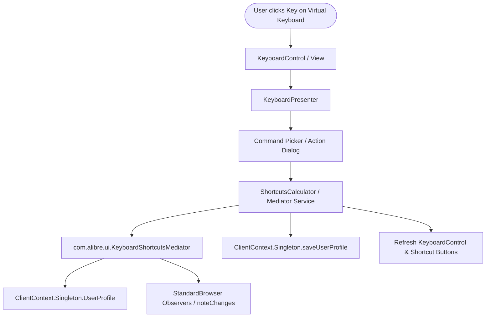

# Requirements

### Overview & Goals
The goal is to determine the feasibility of and implement the ability to view, set, modify, and delete keyboard shortcuts directly by clicking keys on the visual keyboard UI in the Shortcuts Add-On.
By leveraging Alibre Design's native `KeyboardShortcutsMediator`, `ClientContext.Singleton.UserProfile`, and `Profile` structure, modifications will take effect immediately within the active Alibre session and persist to disk for future sessions.

### Scope
- **In Scope:**
  - Interactive key click handling on the virtual keyboard to assign, reassign, or clear shortcuts.
  - Integration with Alibre's in-memory `ClientContext.Singleton.UserProfile` and `KeyboardShortcutsMediator`.
  - Conflict detection, validation, and real-time observer notification (`noteChanges()`) across active Alibre workspaces.
  - Searchable command picker dialog for browsing available workspace commands with icons and localized hints.
  - Persistence of updated shortcuts to the user's roaming profile (`user.profile`).
- **Out of Scope:**
  - Modifying hardcoded system shortcuts reserved by the OS (e.g. `Ctrl+Alt+Del`, Windows keys).
  - Editing keyboard shortcuts for non-Alibre external applications.

### User Stories
- As an Alibre Design user, I want to click any key on the visual keyboard while my desired modifier keys (Ctrl/Alt/Shift) are active so that I can quickly assign a command to that shortcut.
- As an Alibre Design user, I want to click an already-assigned key so that I can see what command is bound, reassign it, or remove the shortcut.
- As an Alibre Design user, I want conflict warnings when assigning a key already bound to another command so that I avoid unintentional shortcut collisions.
- As an Alibre Design user, I want shortcut changes to apply immediately in my open design session without requiring a restart of Alibre Design.

### Functional Requirements
- **Key Selection & State**: Clicking a non-modifier key on the virtual keyboard captures the target key code combined with currently toggled modifiers (`Ctrl`, `Alt`, `Shift`).
- **Command Selection UI**: If the key combination is unassigned, open a searchable command picker listing all available commands for the active workspace profile.
- **Editing Existing Bindings**: If the key is already assigned, provide options to Edit/Reassign, Clear Shortcut, or View Details.
- **Conflict Handling**: Detect if the selected key combination is already bound to another command in the current workspace and offer to overwrite or cancel.
- **Live Workspace Sync**: Commit changes via `KeyboardShortcutsMediator` so active Alibre CAD windows immediately recognize the new shortcut bindings.
- **Persistence**: Save modifications to `ClientContext.Singleton.UserProfile` and write to disk via `saveUserProfile()`.

# Technical Design

### Current Implementation
- `ShortcutsCalculator.cs` reads user shortcuts from disk (`RoamingProfilePath()`) using `BinaryFormatter` and `ProfileSerializationSurrogate`, and provides standard shortcuts via `KeyboardShortcutsMediator`.
- `KeyboardPresenter.cs` and `KeyboardControl.cs` display shortcuts on `ShortcutButton` controls with background colors, icons, and tooltips, but only modifier keys have click handlers. Non-modifier key clicks are not currently wired to assignment actions.
- Alibre Design 29.1 assemblies (`alibre.dll`, `alibre-client.dll`, `alibre-core.dll`) expose:
  - `com.alibre.client.ClientContext.Singleton.UserProfile`: Active in-memory root `Profile`.
  - `com.alibre.client.ClientContext.Singleton.saveUserProfile()`: Persists the profile to disk.
  - `com.alibre.ui.KeyboardShortcutsMediator`: Provides `setShortcut(workspace, commandId, keys)`, `clearShortcut(workspace, commandId)`, `getShortcut(workspace, commandId)`, `isShortcutInUse(workspace, keys, out commandId)`, `isShortcutValid(keys)`, `getCommandIDs(workspace)`, `commitPendingChanges()`, and `noteChanges()`.

### Key Decisions
- **Decision 1: Use `KeyboardShortcutsMediator` for mutation and live synchronization.**
  - *Rationale*: Calling `KeyboardShortcutsMediator.setShortcut` and `commitPendingChanges()` ensures Alibre's internal validation, standard defaults fallback, and `noteChanges()` observers are triggered, instantly updating all active workspace toolbars and menus.
- **Decision 2: Direct access to `ClientContext.Singleton.UserProfile` in Add-On mode.**
  - *Rationale*: Running as an in-process Add-On (`Shortcuts.dll`) gives direct access to the live `UserProfile` object without needing to re-parse binary files from disk on every operation.

### Architecture Diagram

### Proposed Changes
- **`ShortcutsCalculator.cs`**:
  - Add `UpdateShortcut(string workspace, string commandId, Keys keys)` method using `KeyboardShortcutsMediator.setShortcut` followed by `commitPendingChanges()` and `saveUserProfile()`.
  - Add `RemoveShortcut(string workspace, string commandId)` method using `KeyboardShortcutsMediator.clearShortcut`.
  - Add `GetAvailableCommandsForWorkspace(string workspace)` returning command metadata (command ID, localized hint, SVG icon).
  - Add `ValidateShortcut(Keys keys, string workspace, out string conflictCommand)` wrapping `isShortcutValid` and `isShortcutInUse`.
- **`KeyboardPresenter.cs`**:
  - Add `OnKeyButtonClicked(ShortcutButton button, string keyName)` handler.
  - Compute active `Keys` (`(_isCtrlSelected ? Keys.Control : 0) | (_isAltSelected ? Keys.Alt : 0) | (_isShiftSelected ? Keys.Shift : 0) | keyCode`).
  - Open command selection / edit workflow and apply changes.
  - Refresh button visuals (colors, icons, hints, tooltips) immediately upon change.
- **`KeyboardControl.cs`**:
  - Register click events for all `ShortcutButton` instances to delegate to `KeyboardPresenter`.
- **`CommandPickerDialog.cs` (New)**:
  - Windows Forms dialog featuring a search box, list view of available commands with icons and localized hints, and Assign / Remove / Cancel buttons.

### Risks
- **Key Code Mappings**: Certain non-standard or OEM keys may not have 1:1 Windows Forms `Keys` mappings in Alibre's key code dictionary.
  - *Mitigation*: Validate all key assignments using `mediator.isShortcutValid(keys)` before applying.
- **Profile File Concurrency**: Alibre might write to `user.profile` on application exit.
  - *Mitigation*: Modifying `ClientContext.Singleton.UserProfile` directly keeps in-memory state fully synchronized with Alibre's native save lifecycle.

# Testing

### Validation Approach
Verification of shortcut mutation and persistence can be validated through automated/unit tests where possible and structured integration checks inside the Alibre Add-On runtime environment.

### Key Scenarios
- **Assign New Shortcut**:
  - Select a workspace (e.g. `Design Part Browser`).
  - Toggle modifier (e.g. `Ctrl`).
  - Click an unassigned key (e.g. `K`).
  - Select a command from the picker (e.g. `PartCircleCommand`).
  - Verify that the button updates with the command hint, color, and icon, and verify that the shortcut is active in Alibre Part workspace.
- **Modify / Reassign Existing Shortcut**:
  - Click an already assigned button (e.g. `Ctrl+C`).
  - Choose to reassign to another command.
  - Verify that the old command binding is removed and the new command binding is saved.
- **Remove Shortcut**:
  - Click an assigned button and select "Clear Shortcut".
  - Verify that the shortcut button reverts to unassigned state and the command is no longer triggered by that key.
- **Conflict Warning**:
  - Try assigning a key combination already in use.
  - Verify that the conflict notification displays the existing command name and allows user confirmation to overwrite or cancel.
- **Persistence Across Sessions**:
  - Modify a shortcut and restart Alibre Design.
  - Verify that the modified shortcut remains present in `user.profile` and is loaded correctly on startup.

### Edge Cases
- Invalid shortcut combinations (e.g. bare alphanumeric keys without modifiers if disallowed by Alibre validation).
- Workspaces with read-only default profiles.
- Rapid sequential updates without UI freezing.

# Delivery Steps

### ✓ Step 1: Extend ShortcutsCalculator and Profile Management for Shortcut Mutations
Enhance `ShortcutsCalculator` and shortcut management services to support modifying, validating, and saving shortcuts directly against Alibre's in-memory `Profile` and `KeyboardShortcutsMediator`.

- Implement runtime profile access via `ClientContext.Singleton.UserProfile` with fallback to disk file deserialization.
- Add methods for setting, updating, clearing, and validating shortcuts using `KeyboardShortcutsMediator` (`setShortcut`, `clearShortcut`, `isShortcutValid`, `isShortcutInUse`).
- Implement persistence mechanism that commits changes to `ClientContext.Singleton.UserProfile`, notifies workspace observers (`noteChanges`), and persists to disk via `ClientContext.Singleton.saveUserProfile()`.
- Add command listing retrieval for the active workspace using `KeyboardShortcutsMediator.getCommandIDs(workspace)` and localized hint/icon resolution.

### ✓ Step 2: Implement Command Picker and Conflict Resolution Dialog
Create a user-friendly command selection and conflict resolution dialog for assigning commands to keys.

- Implement `CommandPickerDialog` (or context popup) with a searchable list of workspace commands, showing command name, localized description/hint, and DevExpress SVG icon.
- Add conflict detection UI that alerts the user when a shortcut is already assigned to another command, offering replace/override options.
- Provide options to assign, reassign, or remove the shortcut binding from the selected key.

### ✓ Step 3: Wire Interactive Key Clicks in KeyboardPresenter and KeyboardControl
Connect on-screen keyboard key clicks to shortcut mutation workflow and refresh visual feedback.

- Attach click event handlers across all non-modifier `ShortcutButton` controls in `KeyboardControl`.
- In `KeyboardPresenter`, compute the full `Keys` enum combination (`activeModifiers | targetKeyCode`) when a key button is clicked.
- Trigger the command assignment workflow for unassigned keys and context edit/remove menu for assigned keys.
- Refresh the button's visual representation (background color, overlay hint text, SVG icon, and tooltip) and update `KeyboardShortcutForm` report upon successful assignment.